# 🎯 나만의 퀴즈 게임

터미널에서 실행하는 Python 퀴즈 게임입니다.
퀴즈를 풀고, 새 퀴즈를 추가하고, 최고 점수를 기록할 수 있으며, 프로그램을 종료했다가 다시 실행해도 퀴즈와 점수가 유지됩니다.
보너스 과제로 **퀴즈 삭제**와 **점수 기록 히스토리**를 추가로 구현했습니다.

## 1. 프로젝트 개요

- **목적**: Python 기초 문법, 클래스, 파일 입출력, Git 사용법을 하나의 프로그램을 완성하며 익히기
- **언어**: Python 3.10 이상 (외부 라이브러리 없이 표준 라이브러리만 사용)
- **핵심 구조**
  - `Quiz` 클래스: 퀴즈 1개(문제, 선택지 4개, 정답 번호)를 표현
  - `QuizGame` 클래스: 메뉴, 게임 진행, 퀴즈 추가·목록·삭제·점수, 파일 저장·불러오기를 관리
- **데이터 영속성**: 퀴즈 목록, 최고 점수, 게임 기록을 `state.json`에 저장

## 2. 퀴즈 주제와 선정 이유

**주제: Python 기초 문법**

파이썬을 퀴즈주제로 만든이유는 이번주 파이썬 관련 시험이 예정되어 있어, 계속 눈에 익히면 도움이 될꺼 같아 파이썬 기초문법으로 선정했습니다.

## 3. 실행 방법

```bash
# 저장소 복제
git clone https://github.com/okman82/codyssey_E1-2.git
cd codyssey_E1-2

# 실행
python main.py
```

- `python` 명령이 동작하지 않으면 Windows에서는 `py main.py`, macOS/Linux에서는 `python3 main.py`로 실행합니다.
- 실행 위치와 관계없이 `state.json`은 `main.py`와 같은 폴더에 저장됩니다.

## 4. 기능 목록

### 필수 기능

| 메뉴 | 기능 | 설명 |
|---|---|---|
| 1 | 퀴즈 풀기 | 등록된 퀴즈를 순서대로 출제하고 정답/오답을 알려줌. 끝나면 `5문제 중 4문제 정답! (80점)` 형식으로 결과 표시 |
| 2 | 퀴즈 추가 | 문제, 선택지 4개, 정답 번호(1~4)를 입력받아 새 퀴즈를 등록하고 파일에 저장 |
| 3 | 퀴즈 목록 | 등록된 퀴즈의 문제를 번호와 함께 출력 |
| 4 | 점수 확인 | 최고 점수 출력. 아직 풀지 않았으면 안내 메시지 출력 (⭐ 게임 기록 목록도 함께 출력) |
| 6 | 종료 | 데이터를 저장하고 프로그램 종료 |

### ⭐ 보너스 기능

| 메뉴 | 기능 | 설명 |
|---|---|---|
| 5 | 퀴즈 삭제 | 목록에서 번호를 골라 퀴즈를 삭제하고 파일에 반영 (0번은 취소) |
| 4 | 점수 기록 히스토리 | 게임마다 날짜/시간, 푼 문제 수, 맞힌 수, 점수를 저장하고 점수 확인 화면에 출력 |

자세한 내용은 [5. 보너스 과제](#5-보너스-과제)를 참고하세요.

### 최고 점수 기준

- 최고 점수는 **100점 만점 점수**로 저장합니다. (`정답 수 × 100 ÷ 전체 문제 수`, 소수점 버림)
- 퀴즈를 추가·삭제해 문제 수가 달라져도 같은 기준으로 비교할 수 있도록 정답 개수가 아닌 점수를 사용했습니다.
- 퀴즈를 풀 때마다 최고 점수와 비교해 더 높으면 갱신하고, 결과를 즉시 저장합니다.

### 입력 및 예외 처리

| 상황 | 처리 |
|---|---|
| 입력 앞뒤 공백 (예: ` 1 `) | 공백 제거 후 처리 |
| 숫자가 아닌 입력 (예: `abc`) | 안내 메시지 출력 후 다시 입력 |
| 범위 밖 숫자 (예: 메뉴 `9`, 정답 `0`) | 허용 범위 안내 후 다시 입력 |
| 빈 입력 (그냥 Enter) | 안내 메시지 출력 후 다시 입력 |
| `Ctrl + C`, 입력 스트림 종료 | 안내 메시지 출력 후 저장하고 안전하게 종료 |
| 퀴즈가 하나도 없을 때 | 퀴즈 풀기·목록·삭제에서 안내 메시지 출력 |
| `state.json`이 없을 때 | 기본 퀴즈 5개로 시작하고 파일 생성 |
| `state.json`이 손상되었을 때 | 손상된 파일을 `state.json.bak`으로 백업한 뒤 기본 퀴즈로 복구 |

## 5. 보너스 과제

미션의 선택 과제 중 아래 2가지를 구현했습니다.

| 보너스 과제 | 메뉴 | 브랜치 |
|---|---|---|
| 퀴즈 삭제 기능 | 5. 퀴즈 삭제 | `feature/delete-quiz` |
| 점수 기록 히스토리 | 4. 점수 확인 | `feature/score-history` |

두 기능 모두 별도 브랜치에서 작업한 뒤 `main`에 `--no-ff`로 병합했습니다.

### 5-1. ⭐ 퀴즈 삭제

**요구사항**
- 등록된 퀴즈를 삭제할 수 있다.
- 삭제 후 파일에 반영한다.

**사용 방법**
1. 메뉴에서 `5. 퀴즈 삭제`를 선택합니다.
2. 퀴즈 목록이 표시되면 삭제할 번호를 입력합니다. `0`을 입력하면 취소됩니다.
3. 삭제한 문제가 안내되고, `state.json`에 즉시 반영됩니다.

```text
퀴즈 목록
1. Python에서 리스트를 만드는 기호는?
2. 문자열 길이를 구하는 함수는?
...
삭제할 퀴즈 번호를 입력하세요 (취소: 0, 1~5): 2
[문자열 길이를 구하는 함수는?] 퀴즈를 삭제했습니다.
```

**핵심 코드**

```python
def delete_quiz(self):
    if len(self.quizzes) == 0:
        print("삭제할 퀴즈가 없습니다.")
        return

    self.show_quizzes()
    count = len(self.quizzes)
    number = input_number(f"삭제할 퀴즈 번호를 입력하세요 (취소: 0, 1~{count}): ", 0, count)
    if number is None:
        self.running = False
        return
    if number == 0:
        print("삭제를 취소했습니다.")
        return

    removed = self.quizzes.pop(number - 1)
    self.save_state()
    print(f"[{removed.question}] 퀴즈를 삭제했습니다.")
```

| 코드 | 이유 |
|---|---|
| `self.show_quizzes()` | 목록 출력 코드를 새로 쓰지 않고 기존 메서드를 재사용 |
| `input_number(..., 0, count)` | 삭제는 되돌릴 수 없으므로 `0`을 취소 번호로 추가. 공통 입력 함수로 문자·빈 입력·범위 밖 숫자도 처리 |
| `pop(number - 1)` | 화면 번호(1부터)를 리스트 인덱스(0부터)로 바꿔 삭제. 지운 퀴즈를 돌려받아 안내에 사용 |
| `self.save_state()` | 삭제 결과를 파일에 즉시 반영 |

메뉴에 항목을 추가할 때 입력 범위를 `len(self.menu)`로 정해 두었기 때문에, 메뉴 번호 검사 코드는 고치지 않아도 됐습니다.

### 5-2. ⭐ 점수 기록 히스토리

**요구사항**
- 최고 점수뿐 아니라 모든 게임 기록을 저장한다.
- 날짜/시간, 푼 문제 수, 점수를 기록한다.

**사용 방법**
1. `1. 퀴즈 풀기`를 마칠 때마다 기록이 자동으로 저장됩니다.
2. `4. 점수 확인`에서 최고 점수 아래에 전체 기록이 표시됩니다.

```text
현재 최고 점수: 80점

[게임 기록] 총 2회
1. 2026-11-08 22:52:10 | 5문제 중 3개 정답 | 60점
2. 2026-11-08 22:55:41 | 5문제 중 4개 정답 | 80점
```

**핵심 코드**

```python
from datetime import datetime

# play_quiz: 게임이 끝날 때마다 기록 추가
self.history.append({
    "played_at": datetime.now().strftime("%Y-%m-%d %H:%M:%S"),
    "total": len(self.quizzes),
    "correct": score,
    "score": percent
})

if self.best_score is None or percent > self.best_score:
    self.best_score = percent
    print("새로운 최고 점수입니다!")

self.save_state()
```

```python
# load_state: 기존 파일과 호환
history = data.get("history", [])
```

| 코드 | 이유 |
|---|---|
| `datetime.now().strftime(...)` | 현재 시각을 `2026-11-08 22:55:41` 형태의 문자열로 변환. JSON에는 날짜 객체를 바로 저장할 수 없음 |
| `"total"`, `"correct"`, `"score"` | 문제 수가 바뀌어도 기록마다 당시 기준을 알 수 있도록 세 값을 모두 저장 |
| `self.save_state()`를 `if` 밖으로 | 최고 점수일 때만이 아니라 **모든 게임**을 저장 |
| `data.get("history", [])` | `history`가 없는 이전 버전의 `state.json`도 손상으로 처리하지 않고 빈 기록으로 시작 |
| `history` 형식 검사 | 각 기록의 자료형이 다르면 손상된 파일로 판단해 기본 상태로 복구 |

### 보너스 기능 실행 화면

#### 퀴즈 삭제
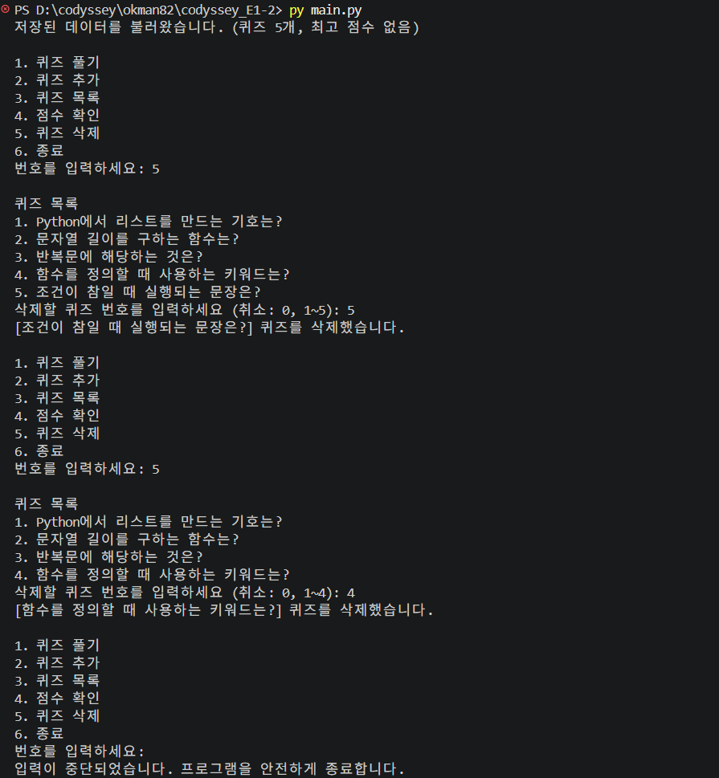

#### 점수 기록 히스토리
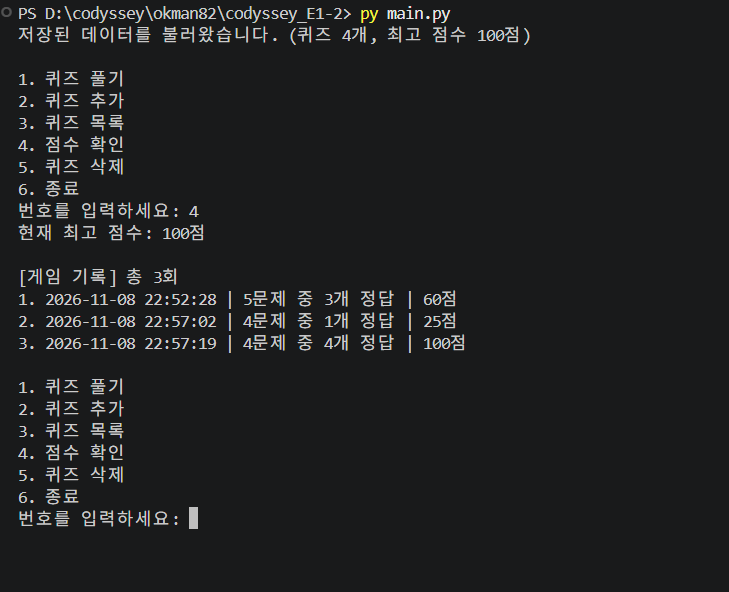

#### `state.json`에 저장된 기록
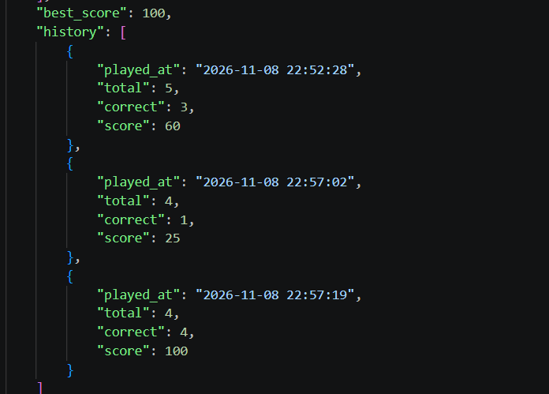

## 6. 파일 구조

```text
.
├── main.py              # 프로그램 전체 코드 (Quiz, QuizGame 클래스, 입력 함수)
├── state.json           # 퀴즈·최고 점수·게임 기록 저장 파일 (없으면 실행 시 자동 생성)
├── state.json.bak       # 손상된 파일의 백업 (손상 시에만 생성, Git 제외)
├── README.md            # 프로젝트 설명
├── STUDY.md             # 미션 준비 학습 노트
├── .gitignore           # Git에서 제외할 파일 목록
├── study/
│   └── ex001.py         # 미션 전 Python 연습 코드
└── docs/
    └── screenshots/     # 실행 화면 캡처
```

### `main.py` 구성

| 구분 | 이름 | 역할 |
|---|---|---|
| 함수 | `input_number(prompt, low, high)` | 범위 안의 숫자를 입력받을 때까지 반복 (공백·빈 입력·문자·범위 검사) |
| 함수 | `input_text(prompt)` | 비어 있지 않은 문자열을 입력받음 |
| 클래스 | `Quiz` | `show()` 퀴즈 출력, `is_correct()` 정답 확인, `to_dict()`/`from_dict()` JSON 변환 |
| 클래스 | `QuizGame` | `run()` 메뉴 반복, `show_menu()` 메뉴 출력, `play_quiz()`, `add_quiz()`, `show_quizzes()`, `show_best_score()`, ⭐ `delete_quiz()`, `save_state()`, `load_state()`, `backup_broken_file()` 손상 파일 백업, `copy_quizzes()` 기본 퀴즈 복사 |

## 7. 주요 코드 설명

### 7-1. 프로그램 실행 흐름

```text
main.py 실행
  └─ QuizGame(default_quizzes) 생성
       └─ load_state()      state.json 불러오기 (없거나 손상 → 기본 퀴즈)
  └─ game.run()
       └─ while 반복: 메뉴 출력 → 번호 입력 → 기능 실행
            1 play_quiz()  2 add_quiz()  3 show_quizzes()  4 show_best_score()
            ⭐ 5 delete_quiz()  6 종료
       └─ finally: save_state()   어떻게 끝나든 저장
```

### 7-2. 공통 입력 함수 `input_number`

숫자 입력이 필요한 모든 곳(메뉴 1-6, 정답 1-4, 삭제 번호 0-N)에서 같은 함수를 재사용합니다.

```python
def input_number(prompt, low, high):
    while True:
        try:
            value = input(prompt).strip()      # 앞뒤 공백 제거
        except KeyboardInterrupt:              # Ctrl + C
            print("\n입력이 중단되었습니다. 프로그램을 안전하게 종료합니다.")
            return None
        except EOFError:                       # 입력 스트림 종료
            print("\n입력 스트림이 종료되었습니다. 프로그램을 안전하게 종료합니다.")
            return None

        if value == "":                        # 빈 입력
            print("입력이 비어 있습니다.")
            continue

        try:
            number = int(value)                # 숫자 변환
        except ValueError:
            print("숫자만 입력하세요.")
            continue

        if low <= number <= high:              # 범위 확인
            return number

        print(f"{low}에서 {high} 사이의 숫자를 입력하세요.")
```

- 올바른 숫자를 입력할 때까지 `while True`로 반복하고, 올바르면 `return`으로 반복과 함수를 함께 끝냅니다.
- 강제 종료 시 `None`을 돌려주고, 호출한 쪽에서 `None`이면 `self.running = False`로 게임을 끝냅니다.
- 범위를 매개변수(`low`, `high`)로 받아 메뉴와 정답 입력 모두에 쓸 수 있습니다.

### 7-3. `Quiz` 클래스와 JSON 변환

```python
class Quiz:
    def __init__(self, question, choices, answer):
        self.question = question
        self.choices = choices
        self.answer = answer  # 1~4 번호로 저장

    def is_correct(self, user_answer):
        return user_answer == self.answer

    def to_dict(self):                 # 객체 → 딕셔너리 (저장용)
        return {"question": self.question, "choices": self.choices, "answer": self.answer}

    @classmethod
    def from_dict(cls, data):          # 딕셔너리 → 객체 (불러오기용)
        return cls(data["question"], data["choices"], data["answer"])
```

- `Quiz` 객체는 JSON 파일에 바로 쓸 수 없어서 `to_dict()`로 딕셔너리로 바꿔 저장합니다.
- 불러올 때는 반대로 `from_dict()`로 딕셔너리를 `Quiz` 객체로 되돌립니다.
- `@classmethod`는 객체가 아직 없는 상태에서 클래스 이름으로 호출하는 메서드입니다. (`Quiz.from_dict(item)`)
- 정답은 리스트 인덱스(0-3)가 아니라 **화면 번호(1-4)** 로 저장해 사용자가 입력한 값과 바로 비교합니다.

### 7-4. 저장 `save_state`

```python
data = {
    "quizzes": [quiz.to_dict() for quiz in self.quizzes],
    "best_score": self.best_score,
    "history": self.history          # ⭐ 보너스
}
temp_file = Path(self.state_file).with_suffix(".json.tmp")
with open(temp_file, "w", encoding="utf-8") as file:
    json.dump(data, file, ensure_ascii=False, indent=4)
os.replace(temp_file, self.state_file)   # 다 쓴 뒤에 원본과 교체
```

- `[... for quiz in self.quizzes]`: 모든 퀴즈를 딕셔너리로 바꿔 새 리스트를 만듭니다.
- 임시 파일에 먼저 쓰고 교체해, 저장 중에 꺼져도 원본이 깨지지 않습니다. ([12-2](#12-2-저장-중-손상-방지) 참고)
- `with open(...)`: 블록이 끝나면 파일을 자동으로 닫습니다.
- `ensure_ascii=False`: 한글을 글자 그대로 저장합니다.
- 쓰기 실패(`OSError`) 시 안내 메시지를 출력하고 프로그램은 계속 실행합니다.

### 7-5. 불러오기와 손상 파일 검증 `load_state`

```python
try:
    with open(self.state_file, "r", encoding="utf-8") as file:
        data = json.load(file)
    # 각 퀴즈의 question(str), choices(4개 list), answer(1~4 int) 형식 검사
    # ⭐ 각 기록의 played_at(str), total·correct·score(int) 형식 검사
    # 형식이 다르면 raise ValueError(...)
except FileNotFoundError:
    # 첫 실행: 기본 퀴즈로 시작하고 파일 생성
except (json.JSONDecodeError, ValueError, OSError):
    # 손상: 안내 후 기본 퀴즈로 복구
```

| 상황 | 원인 | 처리 |
|---|---|---|
| 파일 없음 | `FileNotFoundError` | 기본 퀴즈로 시작, 파일 생성 |
| JSON 문법 오류 (괄호 누락 등) | `json.JSONDecodeError` | 안내 후 기본 퀴즈로 복구 |
| 문법은 맞지만 내용이 잘못됨 (키 누락, 정답 9 등) | 직접 `raise ValueError` | 안내 후 기본 퀴즈로 복구 |
| 읽기 권한 등 파일 오류 | `OSError` | 안내 후 기본 퀴즈로 복구 |

- 손상된 경우 복구하기 전에 원본을 `state.json.bak`으로 백업합니다. ([12-1](#12-1-손상된-파일-백업) 참고)
- 복구할 때는 퀴즈뿐 아니라 최고 점수와 게임 기록도 함께 초기화합니다.
- JSON 문법만 검사하면 `"answer": 9`처럼 **형식은 맞지만 잘못된 데이터**를 그대로 불러와 게임 중 오류가 날 수 있어, `isinstance()`로 자료형과 범위를 직접 검사합니다.
- 정상적으로 불러오면 `저장된 데이터를 불러왔습니다. (퀴즈 N개, 최고 점수 N점)`을 출력합니다. 아직 풀지 않았다면 `최고 점수 없음`으로 표시합니다.

### 7-6. 기본 퀴즈 복사 `copy_quizzes`

```python
def copy_quizzes(self, quizzes):
    return [Quiz(q.question, list(q.choices), q.answer) for q in quizzes]
```

- 기본 퀴즈를 그대로 쓰면 게임 중 퀴즈를 추가·삭제할 때 **원본 기본 퀴즈 목록까지 함께 바뀝니다.**
- 새 `Quiz` 객체와 새 선택지 리스트(`list(...)`)로 복사해, 손상 파일 복구 시 항상 처음 상태의 기본 퀴즈를 쓸 수 있게 합니다.

### 7-7. 퀴즈 풀기와 점수 계산 `play_quiz`

```python
for i, quiz in enumerate(self.quizzes, start=1):
    print(f"\n[문제 {i}]")
    quiz.show()
    answer = input_number("정답 번호를 입력하세요: ", 1, 4)
    ...
percent = score * 100 // len(self.quizzes)

self.history.append({...})           # ⭐ 보너스: 게임 기록 추가

if self.best_score is None or percent > self.best_score:
    self.best_score = percent
    print("새로운 최고 점수입니다!")

self.save_state()
```

- `enumerate(..., start=1)`: 문제 번호(1부터)와 퀴즈를 함께 꺼냅니다.
- `score * 100 // 문제 수`: **곱하기를 먼저** 해야 정수 나눗셈에서 0이 되지 않습니다.
- `best_score is None`: 아직 한 번도 풀지 않은 상태(`0점`과 구분)입니다.
- 게임이 끝날 때마다 즉시 저장해, 도중에 강제 종료되어도 기록이 남습니다.

### 7-8. 안전한 종료 `run`

```python
def run(self):
    try:
        while self.running:
            ...
    finally:
        self.save_state()
```

- `finally`는 정상 종료(메뉴 6), 강제 종료(`Ctrl + C`), 예상치 못한 오류 등 **어떤 경우에도 마지막에 실행**됩니다.
- `self.running`을 `False`로 바꾸면 반복이 끝나도록 해, 각 기능 안에서도 게임 종료를 요청할 수 있습니다.

### 7-9. 프로젝트 루트 경로 고정

```python
STATE_FILE = Path(__file__).parent / "state.json"
```

- `"state.json"`만 쓰면 **명령을 실행한 위치**를 기준으로 파일을 찾습니다.
- `__file__`(`main.py`의 경로)의 폴더(`.parent`)를 기준으로 삼아, 어디서 실행해도 프로젝트 루트의 `state.json`을 사용합니다.

## 8. 데이터 파일 설명 (`state.json`)

- **경로**: 프로젝트 루트 (`main.py`와 같은 폴더)
- **역할**: 프로그램을 종료해도 퀴즈 목록, 최고 점수, 게임 기록이 유지되도록 저장
- **인코딩**: UTF-8 (한글이 그대로 보이도록 `ensure_ascii=False`로 저장)
- **저장 시점**: 퀴즈 추가 시, ⭐ 퀴즈 삭제 시, 퀴즈를 풀 때마다, 프로그램 종료 시, 파일이 없거나 손상되어 기본 퀴즈로 시작할 때

### 스키마

```json
{
    "quizzes": [
        {
            "question": "Python에서 리스트를 만드는 기호는?",
            "choices": ["()", "{}", "[]", "<>"],
            "answer": 3
        }
    ],
    "best_score": 80,
    "history": [
        {
            "played_at": "2026-11-08 22:55:41",
            "total": 5,
            "correct": 4,
            "score": 80
        }
    ]
}
```

| 키 | 자료형 | 설명 |
|---|---|---|
| `quizzes` | list | 퀴즈 목록 |
| `quizzes[].question` | str | 문제 |
| `quizzes[].choices` | list (str 4개) | 선택지 |
| `quizzes[].answer` | int (1~4) | 정답 번호 |
| `best_score` | int 또는 null | 최고 점수 (100점 만점). 아직 풀지 않았으면 `null` |
| ⭐ `history` | list | 게임 기록 목록 (오래된 기록부터). 키가 없으면 빈 목록으로 시작 |
| ⭐ `history[].played_at` | str | 게임 날짜/시간 (`YYYY-MM-DD HH:MM:SS`) |
| ⭐ `history[].total` | int | 푼 문제 수 |
| ⭐ `history[].correct` | int | 맞힌 문제 수 |
| ⭐ `history[].score` | int | 점수 (100점 만점) |

불러올 때 위 형식과 다르면(키 누락, 선택지 개수 오류, 정답 범위 오류 등) 손상된 파일로 판단해 기본 퀴즈로 복구합니다.

## 9. 실행 화면

### 메뉴
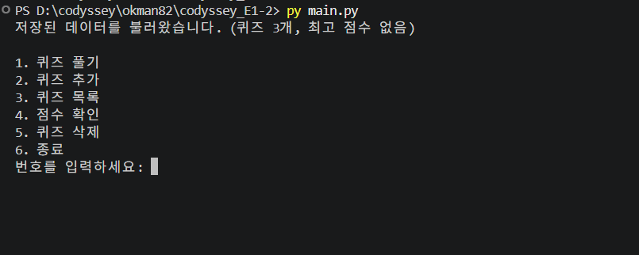

### 퀴즈 풀기
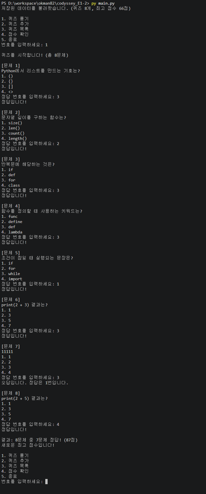

### 퀴즈 추가
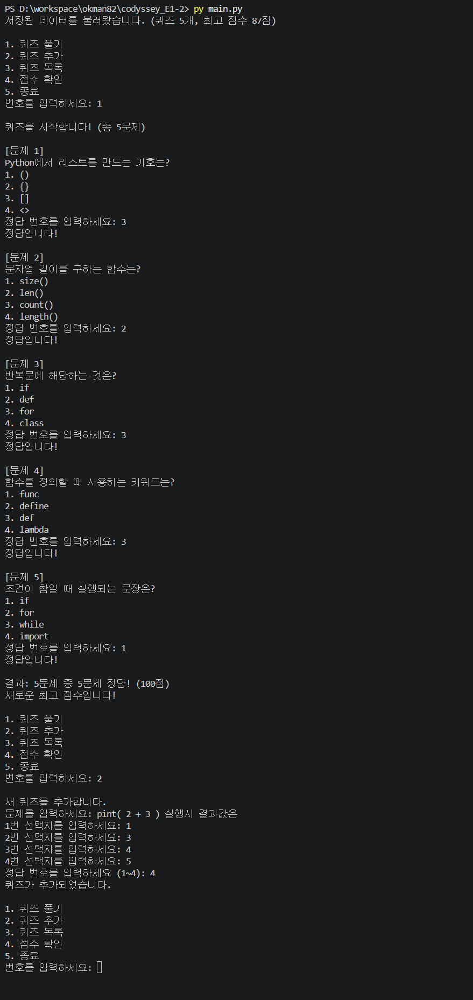

### 퀴즈 추가 후 재시작 시 퀴즈 유지 확인
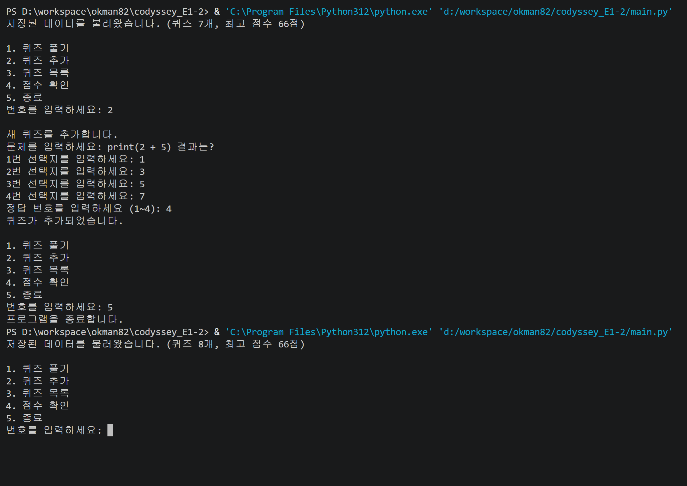

### 퀴즈 목록
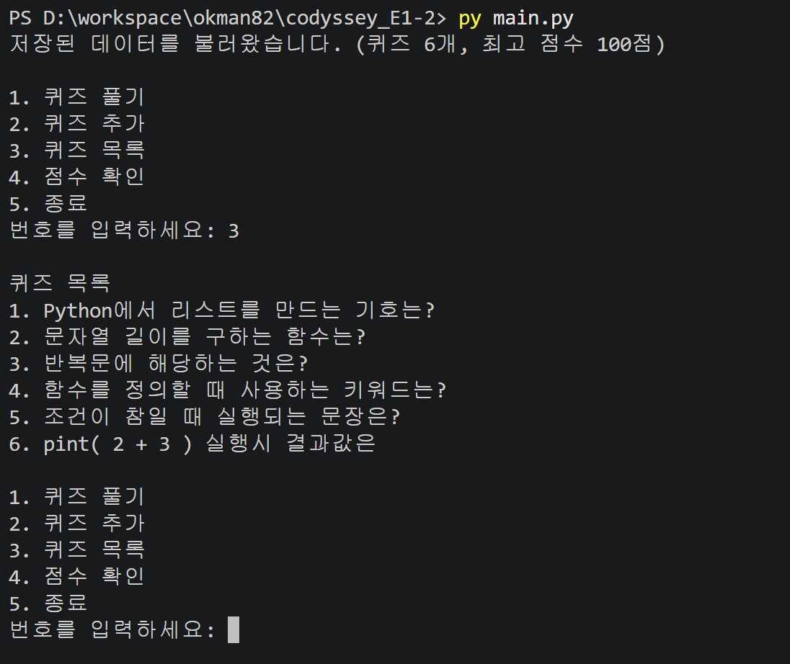

### 점수 확인
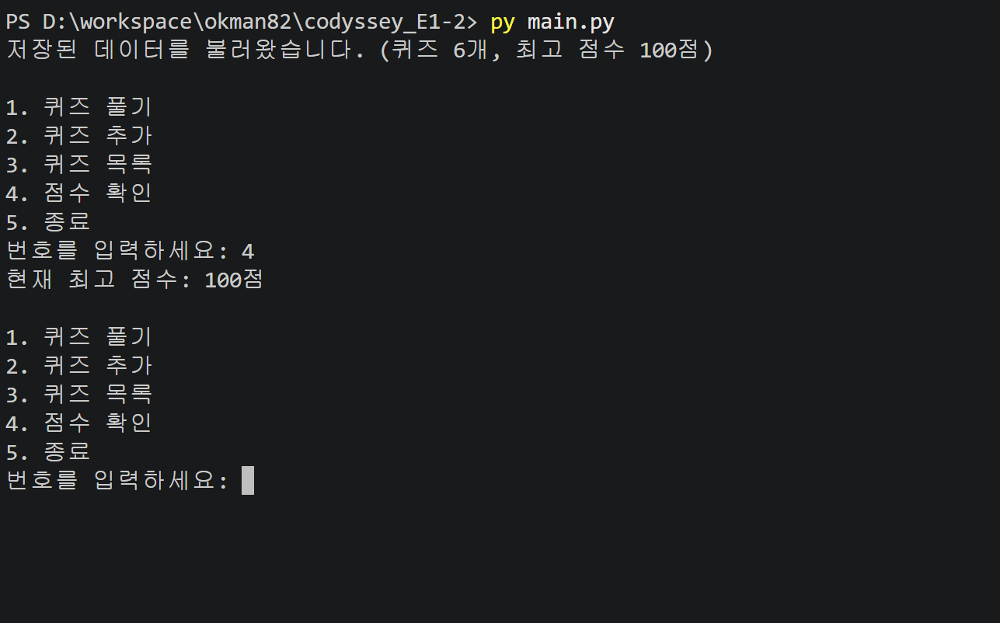

보너스 기능 화면은 [5. 보너스 과제](#5-보너스-과제)에 있습니다.

## 10. Git 작업 기록

### 10-1. 원격 저장소

- **저장소 URL**: https://github.com/okman82/codyssey_E1-2
- **기본 브랜치**: `main`
- **전체 커밋 수**: [51]개 (`git rev-list --count HEAD` 결과)

```text
$ git remote -v
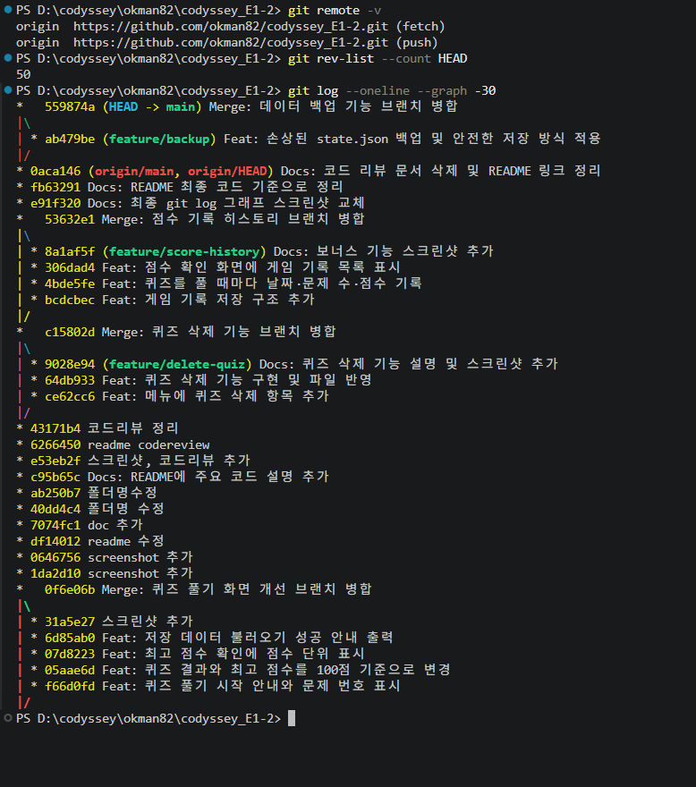
```

### 10-2. 커밋 규칙과 브랜치

- 기능 단위로 커밋하고 메시지 앞에 종류를 붙였습니다: `Feat`(기능), `Fix`(수정), `Refactor`(구조 정리), `Docs`(문서)
- 브랜치에서 작업한 뒤 `main`에 `--no-ff`로 병합해 병합 기록을 남겼습니다.

| 브랜치 | 작업 내용 |
|---|---|
| `feature/play-quiz` | 퀴즈 풀기 화면 개선 (문제 번호, 100점 기준 점수, 불러오기 안내) |
| ⭐ `feature/delete-quiz` | 보너스: 퀴즈 삭제 기능 |
| ⭐ `feature/score-history` | 보너스: 점수 기록 히스토리 |

### 10-3. 커밋 그래프

```text
$ git log --oneline --graph
```


### 10-4. clone / pull 실습

원격 저장소를 다른 폴더에 복제해 수정·push한 뒤, 원래 작업 폴더에서 pull로 변경 사항을 받아왔습니다.

| 순서 | 위치 | 명령 | 결과 |
|---|---|---|---|
| 1 | 다른 폴더 | `git clone https://github.com/okman82/codyssey_E1-2.git clone-test` | 저장소 전체 복제 |
| 2 | 복제 폴더 | README에 한 줄 추가 → `git add` → `git commit` → `git push` | 원격 저장소에 반영 |
| 3 | 원래 작업 폴더 | `git pull` | 복제 폴더에서 만든 커밋을 받아옴 |
| 4 | 원래 작업 폴더 | `git log --oneline -3` | 받아온 커밋 확인 |


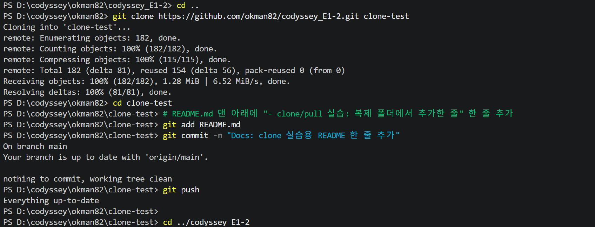
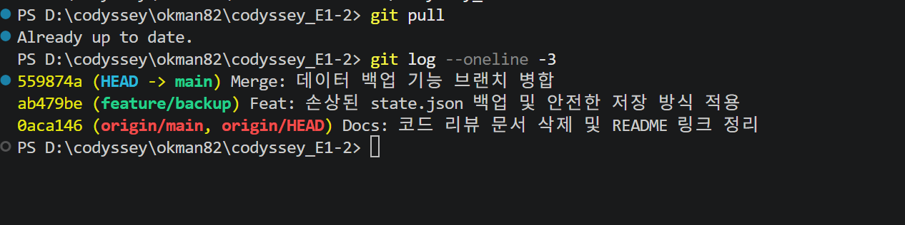

### 10-5. 사용한 Git 명령

| 명령 | 사용한 곳 |
|---|---|
| `init` | 프로젝트 초기 설정 |
| `add`, `commit` | 기능 단위 커밋 |
| `push` | 기능 완성 후 GitHub에 반영 |
| `checkout` | `checkout -b feature/...`로 브랜치 생성, `checkout main`으로 복귀 |
| `merge` | `merge --no-ff`로 브랜치 병합 |
| `clone` | 10-4 실습 1단계 |
| `pull` | 10-4 실습 3단계 |

## 11. 데이터가 많아질 때 (1,000개 이상)

### 11-1. 실제 측정 결과

같은 코드로 퀴즈 수를 늘려 `state.json`을 불러오고(`load_state`) 저장하는(`save_state`) 시간을 측정했습니다. (게임 기록 100개 포함)

| 퀴즈 수 | 파일 크기 | 불러오기 | 저장 | 메모리 사용 |
|---|---|---|---|---|
| 1,000개 | 약 280KB | 약 13ms | 약 6ms | 약 1MB |
| 10,000개 | 약 2.7MB | 약 96ms | 약 58ms | 약 10MB |
| 100,000개 | 약 27MB | 약 1.2초 | 약 0.6초 | 약 105MB |

**결론**: 1,000개 수준에서는 불러오기·저장 모두 사람이 느끼지 못할 만큼 빠릅니다. 10만 개부터 시작 시 지연이 체감되므로, 그 규모라면 아래 개선이 필요합니다.

### 11-2. 기능별 처리량

| 기능 | 처리 방식 | 데이터 N개일 때 | 비고 |
|---|---|---|---|
| 불러오기 | 파일 전체 읽기 + 전체 검증 | N에 비례 | 시작할 때 1번 |
| 저장 | 파일 전체 다시 쓰기 | N에 비례 | 추가·삭제·풀기마다 |
| 퀴즈 추가 | 리스트 끝에 추가 | 일정 | 저장 시간은 N에 비례 |
| 퀴즈 삭제 | `pop(번호)` | N에 비례 | 뒤쪽 항목을 앞으로 당김 |
| 퀴즈 목록 | 전체 출력 | N에 비례 | 화면에 1,000줄 출력 |
| 퀴즈 풀기 | 전체 출제 | N에 비례 | 1,000문제를 한 번에 풀게 됨 |

### 11-3. 예상 병목과 개선 방안

| 병목 | 문제 | 개선 방안 |
|---|---|---|
| 퀴즈 풀기 | 1,000문제를 한 번에 다 풀어야 함 | 문제 수를 선택하고 무작위로 출제 (`random.sample`) |
| 퀴즈 목록 | 화면이 1,000줄로 넘침 | 20개씩 페이지로 나눠 출력, 검색어로 찾기 |
| 게임 기록 | 풀 때마다 계속 늘어남 | 최근 N개만 저장하거나 오래된 기록은 별도 파일로 분리 |
| 저장 | 작은 변경에도 파일 전체를 다시 씀 | 수십만 개 이상이면 SQLite(표준 라이브러리 `sqlite3`)로 변경해 바뀐 행만 저장 |

## 12. 데이터 백업과 안전한 저장

### 12-1. 손상된 파일 백업

`state.json`이 손상되면 기본 퀴즈로 복구하기 **전에** 원본을 `state.json.bak`으로 복사해 둡니다. 직접 추가한 퀴즈가 들어 있는 파일이 덮어써져 사라지는 것을 막기 위해서입니다.

```python
def backup_broken_file(self):
    backup_file = Path(self.state_file).with_suffix(".json.bak")
    try:
        shutil.copyfile(self.state_file, backup_file)
        print(f"손상된 파일은 {backup_file.name}에 백업했습니다.")
    except OSError:
        print("손상된 파일을 백업하지 못했습니다.")
```

```text
state.json 파일이 손상되었거나 읽을 수 없어 기본 퀴즈로 복구합니다.
손상된 파일은 state.json.bak에 백업했습니다.
```

**복구 방법**: `state.json.bak`을 열어 깨진 부분(괄호, 쉼표 등)을 고친 뒤 이름을 `state.json`으로 바꾸고 다시 실행합니다.

### 12-2. 저장 중 손상 방지

저장 도중 프로그램이 꺼지면 파일이 반만 쓰여 손상될 수 있습니다. 그래서 **임시 파일에 먼저 다 쓰고, 성공했을 때만 원본과 교체**합니다.

```python
temp_file = Path(self.state_file).with_suffix(".json.tmp")
with open(temp_file, "w", encoding="utf-8") as file:
    json.dump(data, file, ensure_ascii=False, indent=4)
os.replace(temp_file, self.state_file)
```

- `os.replace`는 파일을 한 번에 교체하므로, 저장 중에 꺼져도 원본 `state.json`은 이전 상태 그대로 남습니다.
- `state.json.bak`, `state.json.tmp`는 `.gitignore`에 추가해 저장소에 올리지 않습니다.

## 13. 요구사항이 바뀔 때 수정할 곳

| 바뀌는 요구사항 | 수정할 곳 | 함께 확인할 곳 |
|---|---|---|
| 점수 계산 방식 (예: 반올림, 가중치) | `QuizGame.play_quiz()`의 `percent` 계산 | `show_best_score()` 출력, README 최고 점수 기준 |
| 선택지 개수 (예: 4개 → 5개) | `Quiz` 생성, `add_quiz()`의 `range(4)` | `load_state()`의 `len(choices) != 4` 검사, `play_quiz()`의 `input_number(..., 1, 4)` |
| 퀴즈에 항목 추가 (예: 힌트, 난이도) | `Quiz.__init__`, `to_dict()`, `from_dict()` | `add_quiz()` 입력, `load_state()` 검증, `state.json` 스키마 |
| 메뉴 추가·변경 | `QuizGame.__init__`의 `self.menu`, `run()`의 분기 | 입력 범위는 `len(self.menu)`라 수정 불필요 |
| 게임 기록 항목 추가 | `play_quiz()`의 `history.append` | `load_state()`의 기록 검사, `show_best_score()` 출력 |
| 저장 방식 변경 (예: JSON → DB) | `save_state()`, `load_state()` | 다른 메서드는 `self.quizzes`만 사용하므로 수정 불필요 |
| 입력 검증 규칙 | `input_number()`, `input_text()` | 모든 입력이 두 함수를 거치므로 한 곳만 수정 |

저장·불러오기가 `save_state()`와 `load_state()` 두 메서드에만 모여 있고, 모든 입력이 공통 입력 함수를 거치기 때문에 변경 범위가 한정됩니다.
